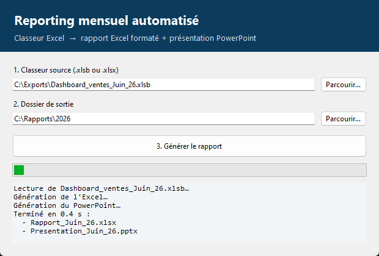

# 📊 Automatisation du reporting mensuel

> Transforme un export Excel brut (`.xlsb` / `.xlsx`) en **rapport Excel formaté** et en **présentation PowerPoint prête pour la réunion** — en quelques secondes au lieu de plusieurs heures de copier-coller.


## 💡 Contexte

Développé pour une équipe commerciale du **secteur pharmaceutique** qui préparait chaque mois, à la main, le tableau de bord des ventes à partir d'un gros classeur binaire `.xlsb` : extraction des chiffres, mise en forme, graphiques, puis recopie dans PowerPoint. **Environ 2 jours de travail ramenés à quelques minutes**, avec une interface graphique utilisable par des personnes non techniques.

> Cette version publique a été **généralisée** (configuration JSON au lieu de noms de feuilles codés en dur) et fonctionne sur des **données 100 % fictives** : aucune donnée du client n'est incluse.



## ✨ Ce que ça génère

**Un classeur Excel** — 6 onglets en vrais *Tableaux Excel* (filtres, lignes alternées), formats `€` et `%`, totaux **en formules** (`=SUM(...)`, jamais de valeurs en dur) :
ventes mensuelles avec taux de réalisation · cumul de l'exercice · trimestres · performance par équipe · top produits · stock et commandes par grossiste.

**Une présentation PowerPoint 16:9** — 6 diapositives :

| # | Diapositive |
|---|---|
| 1 | Couverture avec la période détectée automatiquement |
| 2 | 5 indicateurs clés (ventes du mois, réalisation, cumul, croissance) colorés selon l'atteinte de l'objectif |
| 3 | Graphique natif PowerPoint : ventes vs budget vs N-1, mois par mois |
| 4 | Tableau de performance par équipe |
| 5 | Top 10 produits |
| 6 | Stock et commandes en attente par grossiste |

👉 Exemples téléchargeables dans [`examples/`](examples) : le classeur source fictif, l'[Excel généré](examples/Rapport_exemple.xlsx) et la [présentation générée](examples/Presentation_exemple.pptx).

## 🚀 Utilisation

```bash
pip install -r requirements.txt

python -m reporting_auto --gui                       # interface graphique
python -m reporting_auto Dashboard.xlsb -o rapports  # ligne de commande
python -m reporting_auto --demo -o demo              # essai sur des données fictives
```

## ⚙️ Un moteur configurable

Les exports réels sont « sales » : lignes de titre, en-têtes décalés, lignes de total, intitulés qui changent d'un mois à l'autre. Le moteur :

- **repère chaque feuille** par un mot-clé dans son nom ;
- **trouve la ligne d'en-tête** en cherchant les intitulés attendus (plusieurs variantes acceptées, sans tenir compte des accents ni de la casse) ;
- **recalcule** tous les indicateurs dérivés (réalisation, cumuls, trimestres, croissance) au lieu de les recopier, pour éviter de propager les erreurs du fichier source.

Pour un autre classeur, il suffit d'un JSON (voir [`config.exemple.json`](config.exemple.json)) :

```bash
python -m reporting_auto export.xlsx --config ma_config.json
```

## 🧪 Tests

```bash
pip install -r requirements-dev.txt
pytest
```

Les tests couvrent l'extraction, la cohérence des indicateurs, la détection d'en-têtes et la génération complète ; ils tournent via **GitHub Actions** à chaque push.

## 📁 Structure

```
reporting_auto/
├── reader.py        # lecture .xlsb / .xlsx, détection des feuilles et des en-têtes
├── extract.py       # indicateurs (réalisation, cumuls, trimestres, KPI)
├── excel_report.py  # classeur Excel formaté
├── pptx_report.py   # présentation PowerPoint
├── gui.py           # interface Tkinter
├── sample_data.py   # générateur de données fictives
└── config.py        # configuration par défaut
```

---
Réalisé par **Papa Abou Mbaye** — [Portfolio](https://papaabou.github.io/Portfolio) · [LinkedIn](https://www.linkedin.com/in/papa-abou-mbaye-126ab6364)
